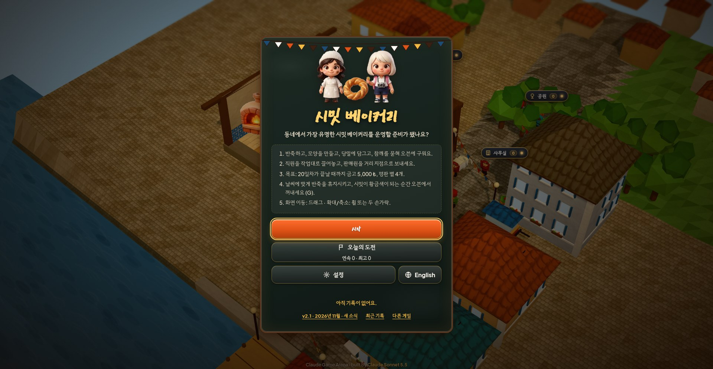
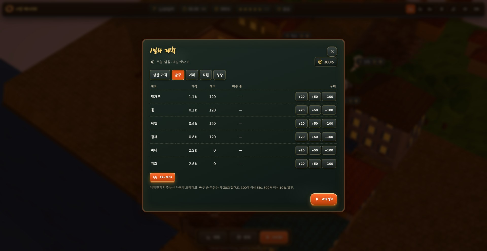
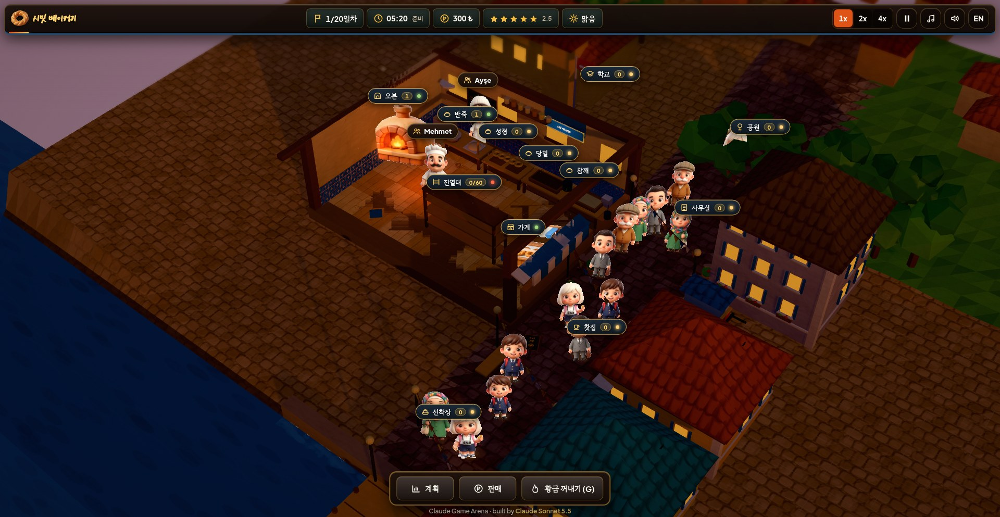

# 시밋 베이커리 (Simit Fırını) — 한국어판

> 원작: **[Furkiozknn/simit-firini](https://github.com/Furkiozknn/simit-firini)** (MIT 라이선스)
> 이 저장소는 원작을 한국어로 현지화한 포크입니다. 영어 원문 README는 [README.en.md](README.en.md)에 그대로 보존되어 있습니다.

<p align="center">
  <a href="https://sigco3111.github.io/simit-firini/">
    
  </a>
</p>

<p align="center">
  <a href="https://sigco3111.github.io/simit-firini/"></a>
</p>

<p align="center">
  
  
  <a href="LICENSE"></a>
  
</p>

<p align="center">
  <strong>이스탄불의 오래된 거리에서 시밋 베이커리를 운영하는 3D 타이쿤 게임. 반죽하고, 모양을 만들고, 당밀에 담그고, 참깨를 묻혀 구운 뒤, 쟁반을 든 시밋 판매원을 선착장·학교·공원·사무실·찻집으로 보내세요.</strong>
</p>

**바로 플레이:** <https://sigco3111.github.io/simit-firini/> — 설치 없이 데스크톱과 휴대폰 브라우저에서 실행됩니다. 첫 화면은 한국어로 시작하며, 타이틀의 언어 버튼으로 한국어 → English → Türkçe 순서로 바꿀 수 있습니다.

## 특징

- **빵집 생산 체인 전 과정:** 반죽 · 성형 · 당밀 · 참깨 · 오븐 5개 작업대를 운영합니다. 직원을 배치하지 않은 작업대는 주인이 대신하며 30% 효율로 돌아가지만, 오븐을 비우면 빵이 타버립니다.
- **살아있는 거리 판매:** 쟁반을 든 판매원(시밋치)을 선착장 · 학교 · 공원 · 사무실 · 찻집 5곳에 보내세요. 시간대와 날씨에 따라 수요가 바뀝니다. 비가 오면 공원과 선착장이 한산해지고, 추우면 찻집이 붐빕니다.
- **하루 단위 전략:** 아침마다 생산 목표와 가격을 정하고, 재료를 발주하고, 직원을 고용하고, 설비를 업그레이드합니다. 20일차까지 금고 5,000 ₺와 평판 별 4개를 달성하는 것이 목표이며, 포아차 · 아츠마 · 차탈 · 피데 레시피가 차례로 열립니다.
- **직접 만지는 3D 경영:** 장면 속 직원을 작업대나 거리 지점으로 드래그해 배치하고, 작업대 라벨을 눌러 실시간 판매 · 수요 차트를 확인합니다. 1x / 2x / 4x 배속을 지원합니다.
- **가벼운 웹 성능:** 단일 `index.html`에 Three.js r170. 원작 기준 Intel UHD 620에서 60 fps를 유지합니다.

## 플레이 방법

> [!TIP]
> **목표:** 20일차가 끝날 때까지 금고 **5,000 ₺** + 평판 **별 4개**. 달성 후에는 무한 모드로 계속할 수 있습니다.

1. **아침 계획:** 매일 아침 가게를 열기 전에 생산 목표와 판매 가격을 정하고, 밀가루와 물을 발주하고, 직원을 배치하고, 설비 업그레이드를 구매합니다.
2. **굽기 관리:** **가게 열기**를 누르고 5개 작업대에 인원을 채우세요. 빈 작업대는 30% 효율로 떨어지고, 오븐이 비면 빵이 탑니다. 시밋이 황금색이 되는 순간 **G** 키(또는 황금 꺼내기 버튼)로 꺼내세요.
3. **거리 판매:** 수요가 높은 지점에 판매원을 보내고, 날씨와 시간대에 맞춰 이동시키며, 손님이 몰리기 전에 쟁반을 다시 채우세요.

**비용과 파산:** 임금 · 임대료 · 땔감은 매일 밤 정산됩니다. 금고가 0 ₺ 아래로 내려가면 파산입니다.

### 조작법

| 동작 | 마우스 / 터치 | 키보드 |
|---|---|---|
| 화면 이동 | 드래그 | 방향키 / `WASD` |
| 확대 · 축소 | 휠 / 두 손가락 | `+` / `-` |
| 작업대 · 지점 패널 열기 | 라벨 클릭 | |
| 직원 이동 | 직원을 작업대나 지점으로 드래그 | |
| 배속 1x / 2x / 4x | 배속 버튼 | `1` `2` `3` |
| 일시정지 / 뒤로 | 일시정지 버튼 | `P` / `Esc` |
| 음악 / 효과음 / 언어 | HUD 버튼 | `M` / `X` / `L` |
| 전체 화면 | 설정 | `F` |

**저장:** 설정(음량, 언어, 화질)은 `arena.simitfirini.settings`, 진행 중인 게임은 `arena.simitfirini.save`, 최고 기록은 `arena.simitfirini.best`, 최근 기록은 `arena.simitfirini.runs` 키로 브라우저 `localStorage`에 저장됩니다.

## 스크린샷

아래 이미지는 모두 한국어판 실제 배포본(<https://sigco3111.github.io/simit-firini/>)을 직접 캡처한 것입니다.

<table>
  <tr>
    <td width="33%"><br><sub>타이틀 화면</sub></td>
    <td width="33%"><br><sub>1일차 계획: 발주</sub></td>
    <td width="33%"><br><sub>플레이 화면 (한국어 HUD)</sub></td>
  </tr>
</table>

원작의 추가 스크린샷(일일 정산, 일시정지 메뉴, 승리 화면, 모바일 레이아웃 등)은 [README.en.md](README.en.md)와 `docs/` 폴더에서 볼 수 있습니다.

## 한국어판에서 바뀐 점

- **전체 텍스트 한국어화:** 게임 내 모든 UI 문자열(342개 키)에 한국어를 추가했습니다. 기본 언어는 한국어이며, 언어 버튼으로 한국어 → English → Türkçe를 순환합니다. 선택한 언어는 저장됩니다.
- **한글 글꼴 내장:** 제목과 칠판 메뉴, 게임 속 간판에는 East Sea Dokdo, 본문에는 Gowun Dodum(고운돋움)의 한글 서브셋을 `assets/fonts/`에 내장했습니다(둘 다 SIL OFL 1.1). 한글 글꼴이 없는 기기에서도 같은 모습으로 표시됩니다.
- **한국어 줄바꿈:** 단어 중간이 끊기지 않도록 `word-break: keep-all` 등 한국어 조판 규칙을 적용했습니다.
- **게임 속 간판도 한국어로:** 가게 간판, 메뉴판, 입간판처럼 3D 장면에 그려지는 글자도 언어 설정을 따라가도록 다시 그리기를 지원합니다.
- **날짜 · 숫자 형식:** `ko-KR` 로케일로 표시합니다.
- **원작 링크 유지:** 크레딧과 "다른 게임" 등 원작자의 링크는 그대로 보존했습니다. 게임 규칙, 경제 밸런스, 세이브 형식은 원작과 동일합니다.

## 기술 노트

- **구성:** 단일 `index.html`(ES 모듈) + `assets/`의 글꼴 · 이미지 파일. 별도 빌드 과정이 없고 GitHub Pages에서 그대로 서빙됩니다.
- **렌더링:** Three.js r170(jsDelivr, MIT), 손으로 그린 듯한 2.5D 화풍, 화덕 불빛 · 김 · 밀가루 입자 효과.
- **오디오:** Web Audio API로 합성한 효과음(화덕 소리, 반죽 소리, 판매원 외침, 빗소리)과 클라리넷 · 다르부카 배경 음악.
- **국제화 구조:** 모든 문자열이 `[튀르키예어, 영어, 한국어]` 3언어 테이블로 관리되며, `t()` 함수가 현재 언어로 조회합니다.
- **테스트용 URL 플래그:** `?auto`(봇 자동 플레이), `?debug`(FPS · 오류 표시), `?lang=en|tr|ko`(시작 언어), `?seed=N`(고정 시드), `?speed=N`(배속), `?low`(저사양 모드) 등 원작의 플래그가 그대로 동작합니다.

## 로컬에서 실행

ES 모듈 특성상 HTTP 서버가 필요합니다(`file://`로는 실행되지 않습니다):

```bash
python -m http.server 8000
```

그 후 <http://localhost:8000/> 을 엽니다.

## 크레딧

- **원작:** [Furkiozknn](https://github.com/Furkiozknn) — [simit-firini](https://github.com/Furkiozknn/simit-firini) (Claude Game Arena 시리즈)
- **제작:** Claude Sonnet 5.5 + Claude Code (원작), 프롬프트: [prompts/simit-firini.md](prompts/simit-firini.md)
- **엔진:** Three.js r170 (MIT, jsDelivr)
- **글꼴:** Patrick Hand (SIL OFL 1.1, 원작 내장), East Sea Dokdo · Gowun Dodum (SIL OFL 1.1, 한국어판 추가)
- 자세한 에셋 출처는 [CREDITS.md](CREDITS.md)를 참고하세요.

## 라이선스

MIT — [LICENSE](LICENSE) (원작과 동일)

원작이 마음에 드셨다면 원작자의 [Buy Me a Coffee](https://buymeacoffee.com/furkiozkann)로 새 라운드를 후원할 수 있습니다. 게임은 계속 무료입니다.
